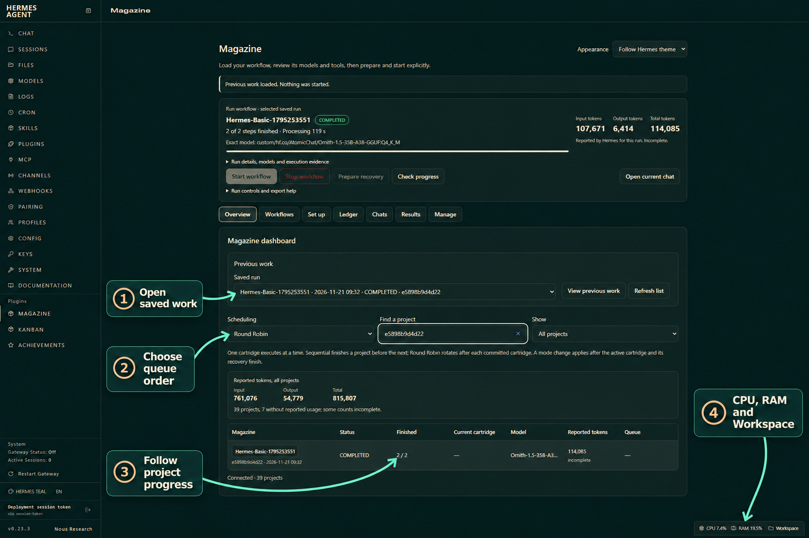

# Magazine for Hermes

Give Hermes a series of small jobs. Choose the models and tools, review the plan,
then start when you are ready. Magazine keeps the work in order and saves what
happened at every step.

Each small job is called a **cartridge**. Each attempt gets a fresh saved chat.
Magazine checks the result and declared files before passing work to the next job.
You can inspect failed attempts, stop work, and download the results and records.

**Current tested preview: 0.1.0-hermes.rc3.**

[Download Magazine](https://github.com/Nundrian/Magazine-for-Hermes/releases/download/v0.1.0-hermes.rc3/Magazine-for-Hermes-0.1.0-hermes.rc3.zip)
· [Release and small example workflows](https://github.com/Nundrian/Magazine-for-Hermes/releases/tag/v0.1.0-hermes.rc3)
· [Checksums](https://github.com/Nundrian/Magazine-for-Hermes/releases/download/v0.1.0-hermes.rc3/SHA256SUMS.txt)



[See all seven tabs with labelled screenshots](docs/UI-GUIDE.md).
The pictures use a small completed test workflow, with original captures available
alongside the annotated versions.

## What you can do

| Tab | What it is for |
|---|---|
| [Overview](docs/UI-GUIDE.md#overview) | Open saved work, see progress and choose which project runs next. |
| [Workflows](docs/UI-GUIDE.md#workflows) | Import a workflow ZIP and review its jobs. |
| [Set up](docs/UI-GUIDE.md#set-up) | Choose exact models and tools, review safeguards, and prepare the work. |
| [Ledger](docs/UI-GUIDE.md#ledger) | See each job's status, attempts and recorded evidence. |
| [Chats](docs/UI-GUIDE.md#chats) | Read the actual worker conversations, tool calls and errors. |
| [Results](docs/UI-GUIDE.md#results) | Inspect saved results and download files or the full run record. |
| [Manage](docs/UI-GUIDE.md#manage) | Review stored workflows and runs, and manage recoverable deletion. |

Magazine follows the colours and fonts selected in Hermes. Firefox and Chromium
are supported. The bottom-right strip shows CPU and RAM readings from Hermes and
a Workspace shortcut. In Docker, those readings describe its Linux environment.

## Start using it

This preview was tested on **Hermes 0.23.3**, build
`caafe5389ae585ef77387a962aee05b1bcf17029`, in Windows Docker Desktop.
Magazine checks the build before running; a changed Hermes build needs verification.

1. Download and extract the plugin ZIP linked above.
2. Open PowerShell in its extracted `magazine` folder. Finish or stop any existing
   Magazine work, then run:

   ```powershell
   powershell.exe -NoProfile -ExecutionPolicy Bypass -File .\scripts\Install-Magazine.ps1 -Container hermes
   ```

3. Refresh Hermes. Select **Magazine** under **Plugins** in the left sidebar;
   scroll the sidebar if needed.
4. Import a small example ZIP in **Workflows**. Review its instructions, models and
   tools in **Set up**, then select **Prepare workflow**.
5. Select **Start workflow** when ready. Preparing or reopening work does not start it.

The installer backs up affected code, settings and state. It keeps unrelated Hermes
settings and existing data. [Full install, update and rollback instructions](magazine-hermes/docs/INSTALL.md).

## How it protects the workflow

- **You choose when work starts.** Reopening a page or restarting does not restart inference.
- **The selected model and tools stay explicit.** Magazine refuses silent model replacement.
- **Handover happens after checks.** It saves the successful chat and checked files
  before the next job can use them.
- **Failures remain visible.** Retries have time limits and a hard ceiling of five
  attempts per cartridge. HALT stops automatic progress; Stop ends a started run.
- **Uncertain execution blocks new work.** If Magazine cannot confirm what happened,
  it requires inspection and explicit reconciliation before recovery.

These safeguards check the execution contract and the identity of saved results.
They cannot prove that any answer or project is correct. Add independent checks
suited to your task. Permitted tools keep their normal Hermes/container authority.

## Learn more

- [Illustrated user guide](docs/UI-GUIDE.md): every tab, its controls and the resource strip.
- [In-depth technical guide](docs/TECHNICAL-GUIDE.md): preparation, models/tools,
  checks, file/data handovers, scheduling, retries, Antiloop, STOP/HALT/UNKNOWN,
  recovery, storage, exports and safeguard limits.
- [Acceptance report](magazine-hermes/docs/ACCEPTANCE.md): real model runs,
  deterministic checks, failed probes and untested cases.
- [Theme checks](magazine-hermes/docs/THEME-UPDATE.md) and
  [CPU/RAM/Workspace checks](magazine-hermes/docs/RESOURCE-STRIP.md).
- [Source and reproducible builds](magazine-hermes/README.md).

The execution baseline includes 13 selected real local-model runs and 28 attempts.
The theme and resource updates were separately checked in Firefox and Chromium,
including the installed release. The reports distinguish real inference from
fixtures and do not claim every possible scenario is tested.

## License

[MIT](LICENSE). Magazine adapts work from
[Magazine for Open WebUI](https://github.com/Nundrian/Magazine) and
[Magazine for Pi WebUI](https://github.com/Nundrian/Magazine-for-Pi-WebUI).
[Pinned references and attribution](magazine-hermes/docs/REUSE.json).
