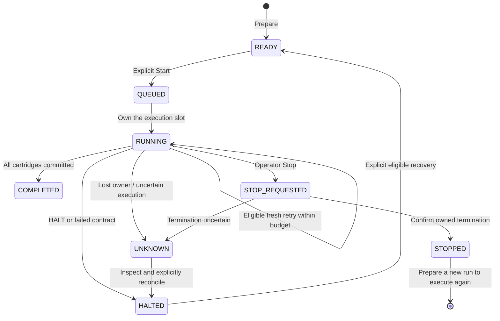

# How Magazine for Hermes works

This guide explains the current implementation, the evidence it records, and the
limits of its safeguards. Start with the [plain-English overview](../README.md)
or the [illustrated tab guide](UI-GUIDE.md) for the everyday workflow.

## Contents

1. [The main objects](#1-the-main-objects)
2. [Importing and preparing work](#2-importing-and-preparing-work)
3. [Models, tools and optional planning](#3-models-tools-and-optional-planning)
4. [One attempt from admission to commit](#4-one-attempt-from-admission-to-commit)
5. [What the checks establish](#5-what-the-checks-establish)
6. [File and structured-data handovers](#6-file-and-structured-data-handovers)
7. [Scheduling and process ownership](#7-scheduling-and-process-ownership)
8. [Retries and time limits](#8-retries-and-time-limits)
9. [Antiloop](#9-antiloop)
10. [DONE, HALT, STOP and UNKNOWN](#10-done-halt-stop-and-unknown)
11. [Recovery and crash boundaries](#11-recovery-and-crash-boundaries)
12. [Ledger, chats, usage and timing](#12-ledger-chats-usage-and-timing)
13. [Results and exports](#13-results-and-exports)
14. [Storage, deletion and backups](#14-storage-deletion-and-backups)
15. [CPU, RAM and Workspace](#15-cpu-ram-and-workspace)
16. [Theme and browser behavior](#16-theme-and-browser-behavior)
17. [Security and compatibility boundaries](#17-security-and-compatibility-boundaries)
18. [Worked example](#18-worked-example)
19. [Failure decisions and troubleshooting](#19-failure-decisions-and-troubleshooting)
20. [Evidence and source map](#20-evidence-and-source-map)

## 1. The main objects

| Object | Meaning |
|---|---|
| Workflow template | An imported set of ordered instructions and declarations. It can be reviewed and used to prepare separate runs. |
| Cartridge | One bounded job: its prompt, routing key, inputs, outputs and relevant execution declarations. |
| Prepared run | A saved snapshot of a workflow and the operator's exact assignments/settings. It begins READY. |
| Attempt | One fresh native Hermes conversation and worker process trying the current cartridge. |
| Publication | A structured result saved by the trusted Hermes adapter, with the controller's identities and a read-back receipt. |
| Commit/checkpoint | The verified, durably stored result, conversation archive and declared artifact bytes that later cartridges may consume. |
| Queue turn | Ownership of execution for a cartridge and its bounded retries. |

Editing a template does not rewrite a prepared run. A failed attempt is retained
as evidence; the next attempt receives a new conversation rather than continuing
that failed conversation's hidden context.

The **runner** owns the queue, verification and advancement. A **worker** receives
one cartridge. The worker's tools do not include the Magazine controller itself.

## 2. Importing and preparing work

### ZIP validation

The importer validates the archive before publishing it into the workflow library.
It checks containment, entry types and resource limits, including absolute paths,
drive paths, backslashes, `..` traversal, links/devices, duplicate names,
case-insensitive/Unicode collisions and file/directory conflicts. Anchored file
operations refuse symlink traversal. A rejected archive does not become a partly
trusted workflow.

Current importer bounds include:

| Bound | Value |
|---|---:|
| Incoming ZIP | 8 MiB |
| Expanded content | 4 MiB |
| Individual file | 1 MiB |
| Manifest | 64 KiB |
| Files / archive entries | 256 / 512 |
| Directory depth | 8 |
| Path length | 240 UTF-8 bytes |
| Expansion ratio, for members larger than 128 KiB | 100:1 |
| Workflow library entries | 128 |

`magazine.yaml` and `magazine.yml` are accepted, including a single enclosing
folder. The manifest uses schema version `1.0`; list order is execution order.
YAML duplicate keys, aliases, anchors and excessive nesting are rejected. Unknown
execution fields are rejected rather than quietly treated as enforced policy.

### Review and immutable preparation

Workflows shows imported templates. Set up shows prompts, exact model assignments,
toolsets, attempt settings and protection controls. Prepare validates the selected
configuration and saves its own workflow/configuration snapshot and hashes.
An incomplete preparation marker prevents Start if snapshot creation did not
finish successfully.

Preparation creates READY state. Import, preview, preparation, refresh, reopening,
chat viewing and restored queue entries do not authorize inference. The operator
must select **Start workflow** explicitly.

Some inherited schema fields are advisory. In particular, accepted `constraints`
and `artifacts.review` declarations are listed as ignored/advisory in preview;
they are not executable semantic validators. Do not put a critical requirement in
one of those fields and assume the runner will enforce it.

## 3. Models, tools and optional planning

### Exact model/provider selection

The adapter reads Hermes' model inventory. For the configured compatible endpoint,
it queries the real model list so stale picker entries do not masquerade as
installed local models. Identifiers remain exact, opaque strings.

The interface supports one workflow model, per-cartridge choices, checkbox bulk
assignment and group assignment. Explicit cartridge assignments take precedence
over supplied routing-key mappings/defaults. Unknown assignments are rejected
before preparation. The worker checks the actual selected model/provider again;
fallback substitution is disabled.

Credentials and provider/context configuration remain with Hermes. Magazine does
not download weights, change quantization or silently enlarge context allocation.
A model being listed does not demonstrate that it will fit memory, follow the
result format or execute tools reliably for a particular job.

### Toolsets are an enforced surface

No toolset is selected by default. A cartridge can independently select an empty
set. Hermes toolsets expand into concrete function definitions; those names are
shown and frozen during preparation. The worker refuses execution if that
expanded allowlist changed and compares the actual model-facing definitions with
the expected surface. Hermes' native tool-search bridge enforces the selected
underlying toolsets as well.

This controls which tools the model can call. It does not create an OS sandbox.
A permitted terminal/code tool can exercise the container's existing authority.
The file-tool write root is scoped to the current Magazine run's workspace folder;
terminal commands can have different capabilities under the container's policy.

### Optional GPT/Claude suggestions

The suggestions panel prepares a brief for an operator-chosen planner. The user
reviews prompts before copying them elsewhere, imports the returned JSON, checks
the proposed before/after assignments, and explicitly selects Apply. Magazine
does not send a remote planner request on the operator's behalf.

Suggestions must refer to the exact workflow/order and available model IDs.
Applying them changes configuration for a new preparation, not the identity of a
running attempt. A suggestion or model-card claim is not a comparative benchmark.

## 4. One attempt from admission to commit

The healthy-path sequence is:

1. The scheduler gives a cartridge the single execution slot.
2. The controller records a new attempt and starts a dedicated worker process.
3. Admission identity is durably written **before** inference-triggering bytes
   are sent to that worker. Kernel execution ownership is inherited by it.
4. The worker verifies Hermes compatibility and creates a new native session ID.
5. It verifies exact model/provider and actual tool definitions, then runs the
   bounded prompt through native `AIAgent` embedding.
6. Native rows and visible stream/tool callbacks provide the conversation view.
7. The adapter reads the saved native final assistant record, including the active
   compression-lineage tip when applicable.
8. A valid structured closing result is published with trusted controller IDs,
   then read back and checked against its receipt.
9. The runner checks declared outputs, selectors, identities and integrity, archives
   the visible conversation, and copies declared artifacts into the Linux-backed
   committed checkpoint.
10. It saves the committed ledger result before returning completion to the core.
    The next cartridge can then be admitted.

The original cartridge prompt is preserved as the prefix of the delivered prompt.
The runner appends the verified input locations/data, bounded attempt context and
required final-result format. A retry receives relevant visible failure context
and candidate-file facts, not an entire recycled failed chat or hidden reasoning.

## 5. What the checks establish

Three kinds of evidence need to be kept distinct:

| Evidence | Establishes | Does not establish |
|---|---|---|
| Actual native tool call/result | A recorded call occurred through the native tool surface, with its visible result/error. | That its side effects satisfy the user's full specification. |
| Valid publication and artifact checkpoint | Correct run/cartridge/attempt/session association; declared data exists and its identity/integrity is consistent. | Semantic correctness of the data. |
| Task-specific external acceptance | The particular independent assertions actually checked, such as exact output bytes. | Every possible future behavior of arbitrary projects. |

A model saying “verified” is a report from the model. In the task result profile,
its `checks` field must have the required shape, but those strings are not an
independently executed test suite. The runner's own checks are the explicit
contract/integrity checks described here.

The real acceptance suite caught a model writing literal backslash-n text while
the execution contract completed. That case is preserved as a failed *task*
acceptance result. A new, explicit-byte fixture subsequently passed. This is why
COMPLETED is not presented as proof of arbitrary real-world correctness.

## 6. File and structured-data handovers

### The closing native result

The recommended `hermes-v1` adapter accepts a strict final object such as:

```json
{"status":"DONE","magazine_result":{"result":{"step":"first","verified":true,"files":["hello.txt"],"checks":["Read the output back"],"note":"The actual requested deliverable or result."}}}
```

The established payload-object plus a separate closing `{"status":"DONE"}` form
is also supported. Presentation prose/fences before an authoritative closing
object carry no execution authority. Duplicate JSON keys, nonfinite numbers,
missing payloads and trailing ordinary text that defeats the closing status are
rejected. An authoritative closing HALT prevents publication/advancement.

The model does not supply trusted run/session IDs. The worker adapter supplies
those identities from the admitted attempt. This adapter is a native-final-record
publisher; it does not inject an extra model-facing publisher tool. Empty toolsets
therefore remain genuinely empty.

### Envelope, receipt and durable commit

The result file envelope contains:

```json
{
  "schema": "magazine.result.v1",
  "run_id": "controller-owned run ID",
  "cartridge_id": "first",
  "attempt_id": "controller-owned attempt ID",
  "session_id": "native root session ID",
  "payload": {"result": {"note": "actual result"}}
}
```

Publication uses anchored, non-link file operations, atomic replacement, fsync
and read-back hashing. The receipt includes the published byte length/hash and
native final source identity. The controller requires a matching receipt and all
four expected identities; an old result file from another attempt cannot qualify
merely because it looks plausible.

Before committing, every declared outgoing JSON selector must resolve in the
payload. Declared files must exist as acceptable regular files; their bytes and
SHA-256 hashes are recorded. The successful visible session is archived and
hashed. Commit copies declared output bytes into native-volume checkpoint storage
and records their identities with the result/session hashes.

Before a dependent uses them, the runner rechecks the committed result, marker,
archived session and required artifact hashes. A mismatch halts progression. Hashes
show that the bytes are the recorded bytes; they do not show that an answer is true.

### Declaring a file dependency

```yaml
artifacts:
  inputs:
    - from: first
      path: hello.txt
  outputs:
    - verified.txt
```

The source must be an earlier cartridge and must have declared that output.
The dependent receives a checked copy under its own `inputs/first/hello.txt`.
It does not consume a producer's uncommitted working candidate by accident.

### Declaring a structured-data dependency

```yaml
handover:
  - from: first
    select: /result/note
    as: previous_summary
```

The selector is a JSON Pointer into the producer's committed payload. The selected
value is delivered in the dependent's bounded prompt under the supplied label.
Pointer existence and source identity are checked; the meaning of the selected
text still needs task-specific review. Treat inherited text as task data.

The legacy final-text mode supports text-only compatibility. It cannot declare
committed file or structured-data handovers. Choose the mode explicitly during
setup rather than assuming legacy text gets the stronger contract.

## 7. Scheduling and process ownership

Sequential finishes the active project's remaining cartridges before another
project receives a turn. Round Robin rotates eligible projects at safe committed
cartridge boundaries. With two two-step projects, healthy orders are:

| Mode | Order |
|---|---|
| Sequential | A1 → A2 → B1 → B2 |
| Round Robin | A1 → B1 → A2 → B2 |

Retries belong to the current cartridge's turn. A1 attempt 2 does not race B1.
A mode change applies after the current cartridge and its retries settle.

The owner daemon uses a kernel file lock. A second inherited execution lock gates
Magazine workers across installation processes/profiles sharing the Hermes root.
There is one inference slot for Magazine, rather than a Python-only in-memory
promise that separate processes could ignore.

The scheduler's SQLite transaction/checkpoint and journal are authoritative; its
JSON cache is an inspectable export. Persistence failure fences dispatch. Multiple
profiles do not silently merge their independent queues: competing execution
fails closed through the shared lock. Ordinary Hermes chats and other applications
are outside this Magazine scheduler.

## 8. Retries and time limits

| Setting | Default | Accepted bound |
|---|---:|---:|
| Total attempts per cartridge | 5 | 1–5 |
| Seconds per fresh attempt | 1,800 | 1–7,200 |
| Separate transient storage retries | 2 | 0–5 |

The five-attempt ceiling includes the initial attempt and survives manual recovery
of that run. A new explicit Start does not reset an exhausted cartridge to zero.
Every new attempt receives a fresh saved session and a fresh full attempt budget.

The ledger records a failure code, classification, fingerprint and decision.
Recoverable completion omissions may retry; hard identity/integrity/configuration
failures, authoritative HALT, operator STOP and exhaustion stop progression.
Repeated non-completion failure without verified progress can stop earlier.

`retry_safe` affects the scope of automatic follow-up. An eligible repair attempt
may repair the same bounded task when declared safe. Otherwise the prompt limits
the follow-up to verification/publication of existing candidates and asks for HALT
when that cannot be done. Earlier files are unverified candidates until checked.
This is not a general planner that invents a new workflow or switches models.

Storage retries are separate from model attempts. Only recognized transient OS
errors are retried, with bounded short backoff. Permission errors, missing required
files and exhausted storage retries do not receive endless busy-loop retries.

An attempt timeout first goes through owned-process cleanup. Only confirmed local
termination permits the timeout to be recorded as an eligible failure. An exception
or uncertainty during cleanup persists UNKNOWN and fences new admission.

## 9. Antiloop

Antiloop consumes structured native tool-call and tool-result events, correlates
them by call ID, deduplicates repeated observations and keeps bounded history.
Reasoning, ordinary words, silence and slow generation do not count as loop proof.

Default thresholds are a warning after three identical call/result repetitions,
a stop after five, a stop after three identical errors, or three repeated short
cycles of width two through four. Successful mutating-tool progress resets the
history unless a result explicitly reports no change. Batches and seen identities
are bounded to avoid counting repeated snapshots indefinitely.

Hermes appends changing loop-count notes to otherwise identical results. The
adapter compares canonical structured JSON only when the remaining suffix consists
entirely of recognized native loop annotations. Unknown suffixes remain opaque.
Full original text remains in Chats; a raw result hash is retained alongside the
comparison hash. Nonzero terminal exit codes count as error outcomes.

On confirmed detection the controller requests interruption of the actual worker,
waits for acknowledgement/termination, and records the evidence. It does not launch
another attempt while the previous owned worker may remain alive.

## 10. DONE, HALT, STOP and UNKNOWN

These are operator-facing states; UNKNOWN is also an installation-wide admission
gate rather than merely a label on one failed cartridge.



**DONE** is accepted only through the appropriate final response and execution
contract. Ordinary code blocks do not prove execution. An incidental quoted DONE
or HALT in a tool log is not an instruction to advance or halt.

**HALT** is the worker's authoritative closing blocked status. It stops automatic
retry/advancement and preserves the attempt for inspection.

**STOP** is an operator action, not a pause. The controller stops dispatch, asks
the agent to interrupt, terminates known owned worker processes/descendants when
needed and waits for confirmation. A started STOPPED run is not resumable through
Prepare recovery; prepare a new run if execution is desired again. Stopping a run
still waiting for its *first* turn only removes it from the queue and leaves READY.

**UNKNOWN** means the controller cannot establish a safe execution conclusion.
New Start actions are blocked. A missing connection is not treated as proof that
the model did nothing, and an old admission is not simply submitted again.

Local process termination is not a universal cancellation receipt for remote
services or external side effects. Inspect already accepted external actions when
reconciling uncertainty. A privileged shell can deliberately detach a process;
the implementation is not an arbitrary hostile-process containment sandbox.

## 11. Recovery and crash boundaries

For an eligible HALTED/interrupted cartridge, inspect its chats, failure decision,
candidate files and committed predecessor evidence. Prepare recovery verifies the
checkpoint and returns eligible work to READY. It does not start inference. Start
must be chosen again explicitly, and the original total-attempt ceiling still applies.

Completed predecessors are preserved. If a process died after durable result commit
but before the core advanced its state, the executor verifies the existing commit
and archived final response and returns that stored result; it does not re-run the
model merely to clean up the bookkeeping window.

An unclean generation with admitted work produces UNKNOWN. Reconciliation checks
the saved process admission/identity and refuses a known live worker. The operator
must inspect native evidence and external side effects, explicitly acknowledge
reconciliation, then prepare recovery and explicitly Start when appropriate.
Deleting a lock or editing a status file is not a safe recovery procedure.

Restart restores queue order/mode as retained entries requiring Start. Browser
refresh, dashboard restart, container restart and process reconnection do not
authorize automatic continuation. The acceptance report distinguishes an actual
engine crash and a disposable container restart from an untested Docker Desktop
daemon restart or power-loss scenario.

## 12. Ledger, chats, usage and timing

### Ledger

Ledger shows one selected cartridge with the compact Cartridge / Status / Attempts /
Tokens row. Expand cartridge details and each attempt for exact model/provider,
start/finish times, timeout, tools, error/decision, publication/checkpoint evidence
and native conversation links. All attempts remain visible, including failures.
Selection and expansions are remembered per browser; the active run takes priority
when reopening, otherwise the last selected run is restored without inference.

### Chats

Chats is a read-only view of retained Magazine worker sessions. It includes visible
user/assistant messages, tool arguments, tool results, errors and timestamps. It
does not include unrelated ordinary Hermes conversations or provide an input box
that could steer a running worker. Switching to history does not interrupt work.

The adapter reads typed native persistence and follows native compression lineage.
Display reads include archived visible history; final publication reads the active
tip while the attempt retains its stable root identity. Live callbacks bridge the
gap before native DB flushes; saved records replace temporary stream projections.
Generation/cursor fingerprints support reset/replay on reconnection. Private
reasoning fields are omitted. Text/HTML from tools is rendered inertly.

### Tokens and time

Usage comes from native reported cumulative counters, stored once per attempt.
Refreshing recomputes snapshots rather than adding the same counter repeatedly.
Run/cartridge totals aggregate distinct attempt snapshots, including retries.
Missing dimensions remain unavailable; known zero requires explicit native usage.
Per-call coverage and unreported cache dimensions remain incomplete rather than
being estimated. Reasoning counts are not added again to output totals.

Processing time sums recorded attempt intervals, including retries. Active elapsed
time updates while an attempt is running. Wall-clock age since preparation is
shown separately; queue waiting and idle time are not presented as model processing.

## 13. Results and exports

Results reads saved canonical work and committed handovers. A results ZIP contains
canonical results, the attempt ledger/configuration evidence and rechecked declared
artifact bytes. It rechecks checkpoint integrity before exporting successful files.

| Export | Use |
|---|---|
| Results ZIP | Deliverables plus their ledger/checkpoint context. |
| Full run JSONL | Retained conversation lines, cartridge definitions, handovers, execution history and explicitly identified snapshots. |
| Ledger JSON | Structured attempt/status/decision evidence. |
| Execution-history JSONL | Persisted history records for audit/review. |

The exporter refuses changing or unsafe snapshots rather than fabricating an
internally inconsistent history. It labels snapshots as snapshots; unrecorded
events are not reconstructed as if they had been observed. Known credential values
and recognized secret fields/assignments are redacted from textual evidence.
Declared artifact bytes retain their checked identity, so independently review
files before sharing them outside the trusted operator's environment.

## 14. Storage, deletion and backups

Executable plugin files live under `plugins/magazine`; runtime state is separate
under `plugin-data/magazine`. Native SQLite stores, scheduler state, immutable
snapshots and checkpoints stay on the Linux-backed volume. The existing mounted
workspace exposes output files under `/workspace/magazine-runs/<run>/...`.

Manage treats workflow templates and saved runs separately. Deleting a template
does not rewrite/delete an existing run snapshot. Deleting eligible Magazine state
moves it into recoverable managed trash. Actual Windows/project files remain in
place. Active, queued or uncertain dependencies block unsafe deletion; the UI shows
a preview and confirmation step before the destructive action.

The installer refuses live/uncertain work, creates private configuration/code/state
backups and online backups of affected native SQLite stores, then stages the new
plugin. It preserves unrelated configuration and native data. Docker installation
as root assigns Magazine-managed files/locks to the native service owner while
preserving modes; it does not recursively change the whole home or other plugins.

Uninstall retains runtime data, conversations and workspace files. Code rollback
uses an exact backup path and the same idle/backup safeguards; newer runtime data
is not silently downgraded. Future incompatible schema migrations need separate
restore testing. See [installation/rollback instructions](../magazine-hermes/docs/INSTALL.md).

## 15. CPU, RAM and Workspace

The bottom-right strip reads Hermes' existing authenticated `/api/system/stats`
endpoint. It polls while visible, avoids overlapping reads, times out stalled
reads, and stops its timer when the plugin unmounts. Failure/missing values show
an em dash, not an assumed zero. A reported zero remains a valid reading.

These are the same system-environment measurements Hermes reports. In Docker,
they describe its Linux environment/VM and are not Windows Task Manager totals,
the Magazine process alone, GPU load or VRAM usage. RAM hover text includes the
reported used/total GiB; CPU/RAM scope is explained in tooltips.

Workspace shows `/workspace` and the selected run's own subdirectory, offers path
copying, and links to verified Results and native Hermes Files. The native Files
browser keeps its existing access policy. In the tested Docker build it is locked
to `/opt/data`, so a separate `/workspace` mount can be outside that browser.
The shortcut displays that restriction rather than weakening it or claiming that
the Files page opened a directory it cannot browse. Use the Docker bind mount on
the host or the existing terminal access to work directly with that mounted path.

Current workspace candidates and verified committed Results are different views:
editing a live candidate does not rewrite the stored verified checkpoint.

## 16. Theme and browser behavior

Follow Hermes is the default. Magazine maps the actual native palette tokens for
canvas, cards, secondary surfaces, borders, inputs, selected tabs, buttons, text,
code, errors and success. References remain live CSS variables, so native theme
changes apply immediately. Fonts follow the native theme/override settings too.

Explicit Magazine dark/light palettes remain available and remembered. The compact
ledger, panel controls, keyboard tab navigation and read-only history remain the
same workflows across themes. Firefox and Chromium are verified; narrow layouts
are checked separately. Refresh an already-open page after installing changed assets.

## 17. Security and compatibility boundaries

The native dashboard's authentication and enabled-plugin gate protect the bridge.
The controller uses a private 0600 Unix socket and a separate process; it exposes
no new unauthenticated TCP orchestration service. Blocking orchestration is kept
out of the dashboard event loop.

The current gate pins Hermes 0.23.3 and installed code identity
`caafe5389ae585ef77387a962aee05b1bcf17029`, plus required embedding controls. Native
plugin validation passes but discloses the documented embedding seam's imports
outside the plugin catalog's narrower allowlist and the Linux rename helper's
proc-access warning. These are version-sensitive dependencies; a mutable image
tag or a newer online document is not compatibility acceptance.

The trusted operator controls model/tool choices. Tool allowlists are real dispatch
controls, but permitted tools retain native container authority. Imported/model
content remains untrusted data. Integrity hashes, prompt instructions and a
single-operator dashboard do not create multi-tenant ACLs or an OS sandbox.

## 18. Worked example

A small two-step workflow can declare the file contract explicitly:

```yaml
schema_version: "1.0"
name: Two-file handover
handover_mode: result_file_v1
recovery:
  max_attempts: 5
  attempt_seconds: 1800
cartridges:
  - id: first
    model: general
    prompt: >-
      Use write_file to create outputs/hello.txt containing HELLO MAGAZINE
      followed by one real line feed U+000A. It must be exactly 15 bytes.
      Read it back and return the structured checked result.
    artifacts:
      outputs: [hello.txt]
    retry_safe: true
  - id: second
    model: general
    prompt: >-
      Read inputs/first/hello.txt. Write outputs/verified.txt containing
      HELLO MAGAZINE VERIFIED followed by one real line feed U+000A,
      exactly 24 bytes. Read it back and return the structured result.
    artifacts:
      inputs:
        - from: first
          path: hello.txt
      outputs: [verified.txt]
    retry_safe: true
```

Choose an exact installed model and the Hermes `file` toolset, prepare, then Start.
The first attempt writes the working file and publishes its native final result.
Magazine checks and publishes the result, archives the session and commits the output
bytes. The second cartridge receives the rechecked input copy. The independent
acceptance harness then checks the actual 15/24-byte content. That final byte
assertion is task acceptance, beyond the generic declared-file integrity contract.

## 19. Failure decisions and troubleshooting

| Observation | Meaning / appropriate next step |
|---|---|
| Model unavailable or tool functions changed | Review exact inventory/assignments; prepare a new valid snapshot. Substitution is refused. |
| DONE_MISSING / OUTPUT_MISSING | Final completion contract or declared file is missing. Inspect the actual attempt and bounded retry decision. |
| Identity/receipt/checkpoint mismatch | Integrity failure. Stop and inspect source evidence; do not relabel it DONE. |
| ATTEMPT_TIMEOUT | The fresh attempt exceeded its configured time budget after owned cleanup. Inspect the retry decision and task scope. |
| LOOP_DETECTED | Structured repeated-call/error/cycle evidence reached a threshold. Review the actual calls/results before recovery. |
| HALT_RECEIVED | The worker explicitly reports a blocked job. Resolve the stated issue before eligible manual recovery. |
| STOPPED | The operator stopped a started run. Prepare a new run to execute again. |
| UNKNOWN / STOP_UNCONFIRMED | Inspect retained process/session/external-side-effect evidence and explicitly reconcile; do not submit duplicate work. |
| Five attempts used | The run has exhausted that cartridge's ceiling. A sixth attempt is refused. |
| Resource readings are dashes | Native measurements are missing/unreachable. This alone does not halt or certify a cartridge. |
| Workspace is outside native Files root | Use the displayed host/container path or verified Results; existing file-browser restrictions remain. |

## 20. Evidence and source map

The [acceptance report](../magazine-hermes/docs/ACCEPTANCE.md) records passing cases,
failed development probes, corrections and remaining limits. Real local-model runs,
native storage fixtures, injected faults, process checks and browser display
fixtures are identified separately. Completion messages alone are not the evidence.

| Area | Main source |
|---|---|
| UI, theme, resource strip, Workspace | [entry.mjs](../magazine-hermes/dashboard/dist/entry.mjs) |
| Authenticated host bridge / owner | [plugin_api.py](../magazine-hermes/dashboard/plugin_api.py), [daemon.py](../magazine-hermes/daemon.py) |
| Preparation and service composition | [service.py](../magazine-hermes/service.py), [ui_support.py](../magazine-hermes/ui_support.py) |
| Worker and process control | [hermes_worker.py](../magazine-hermes/hermes_worker.py), [hermes_dispatch.py](../magazine-hermes/hermes_dispatch.py) |
| Per-cartridge contract and retry | [executor.py](../magazine-hermes/executor.py), [protocol.py](../magazine-hermes/protocol.py), [ledger.py](../magazine-hermes/ledger.py) |
| Handovers and checkpoints | [handover.py](../magazine-hermes/handover.py) |
| Queue and ownership | [scheduler.py](../magazine-hermes/scheduler.py), [core](../magazine-hermes/magazine/) |
| Loop and usage accounting | [antiloop.py](../magazine-hermes/antiloop.py), [tokens.py](../magazine-hermes/tokens.py) |
| Import/export and installation | [beta5_helpers.py](../magazine-hermes/beta5_helpers.py), [run_export.py](../magazine-hermes/run_export.py), [install.py](../magazine-hermes/scripts/install.py) |

Pinned reference provenance and MIT attribution are in
[REUSE.json](../magazine-hermes/docs/REUSE.json). The detailed architecture and
security documents remain useful alongside this explanation.
