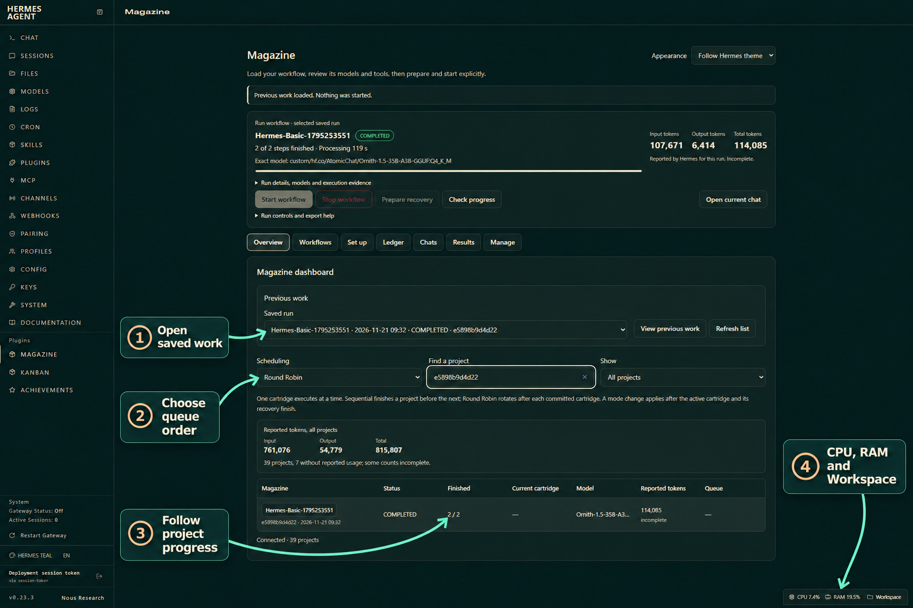
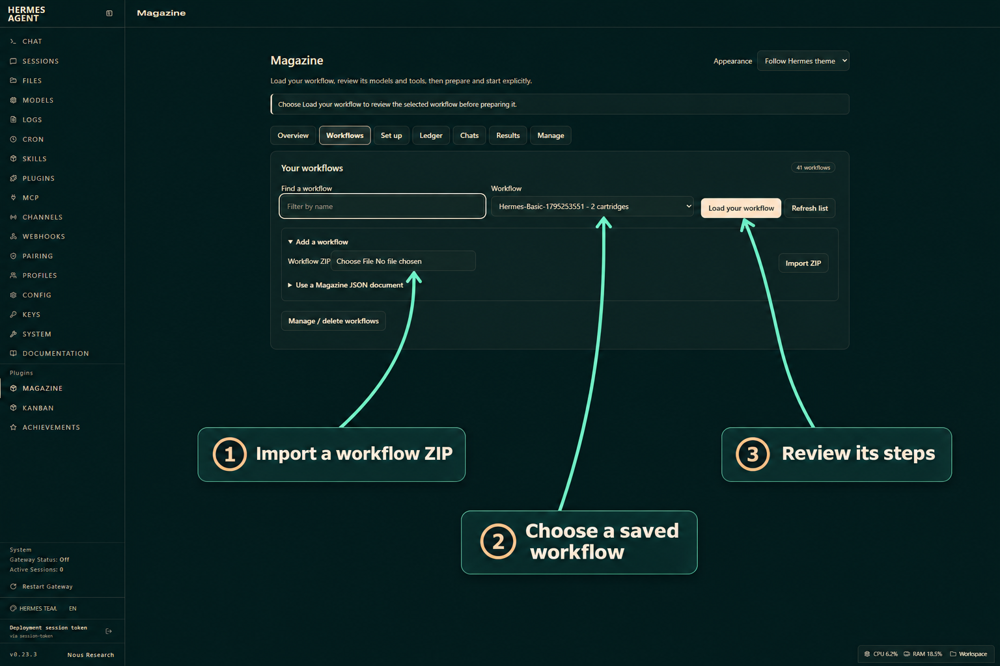
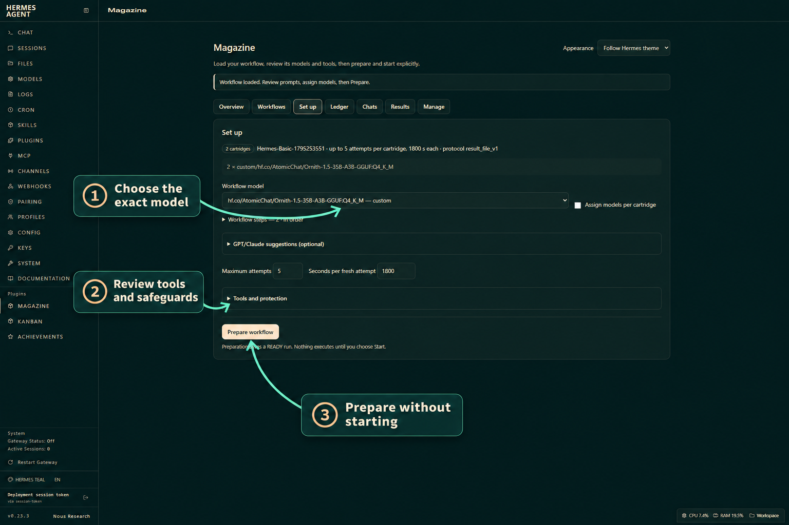
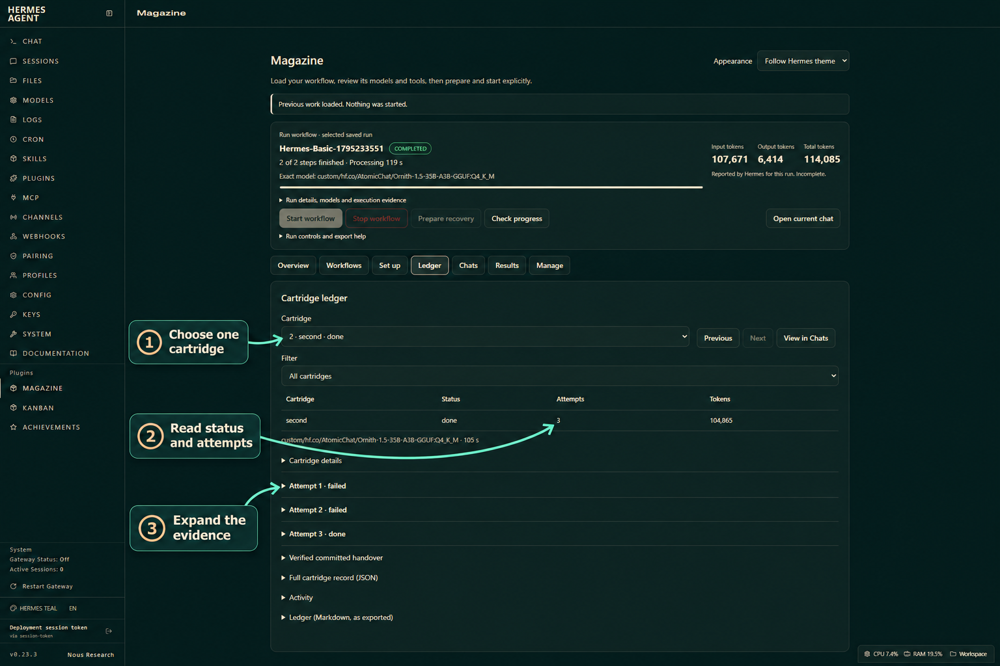
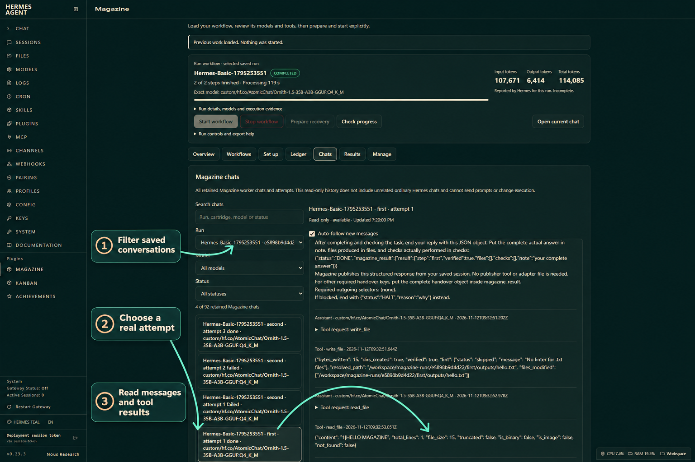
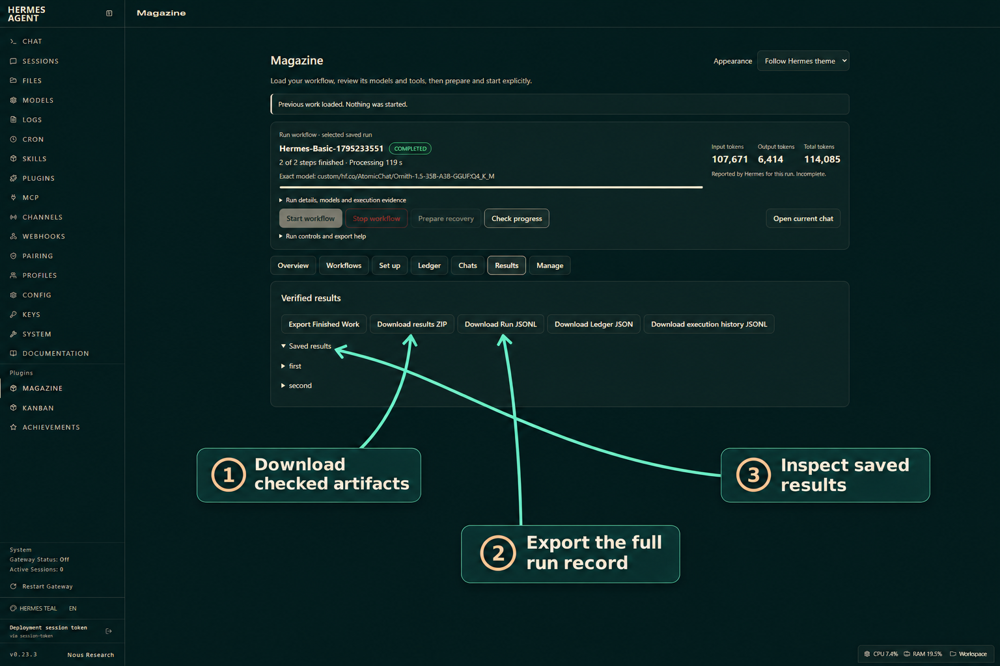
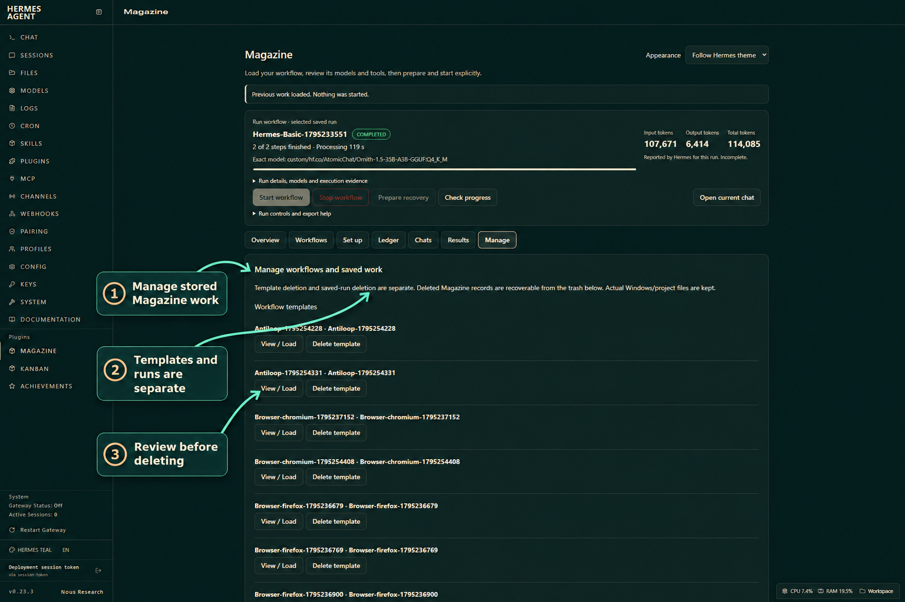

# A tour of Magazine

Magazine turns a prepared workflow into small jobs called cartridges. Review the
jobs, choose exact models and tools, prepare, then explicitly Start. The runner
checks and records each attempt before allowing a successful handover.

[Plain-English introduction](../README.md) · [In-depth technical guide](TECHNICAL-GUIDE.md)

The screenshots below come from the real Hermes dashboard in a disposable test
installation. They show a small completed two-file workflow and its actual saved
attempts. Set up shows the template configuration preview; it does not change that
completed run. No new model calls were made to take these pictures. Arrows and
labels were added for explanation; use each original capture for exact small text
and readings. [Image provenance and annotation prompts](images/ANNOTATIONS.md).

## Overview

1. **Open saved work.** Choose a previous run and view its saved state. Loading it
   does not start another attempt.
2. **Choose queue order.** Sequential finishes one project before the next.
   Round Robin rotates projects after a committed cartridge. Only one cartridge
   executes at a time; its retries keep that turn.
3. **Follow progress.** Filter the project list and inspect status, completed steps,
   reported token usage and processing time.
4. **CPU, RAM and Workspace.** The bottom-right strip stays available across tabs.

[Original Overview capture](images/raw/overview.png).

## Workflows

1. **Import a workflow ZIP.** Importing validates the archive and adds a template
   to the library. It does not run its prompts.
2. **Choose a saved workflow.** Select an imported template from the library.
3. **Review its steps.** Load its preview, read the jobs and continue to Set up.
   Prompts and declarations should describe bounded, checkable work.

Templates and prepared runs are separate. Later edits or deletion of a template
do not rewrite the snapshot inside an existing prepared run.

[Original Workflows capture](images/raw/workflows.png).

## Set up

1. **Choose the exact model.** Use one model for the workflow or assign models to
   individual/selected groups of cartridges. Magazine uses the exact available ID.
2. **Review tools and safeguards.** Expand each section to check prompts, selected
   toolsets and their concrete functions, attempt limits and Antiloop settings.
   No toolset is selected by default. Optional planner suggestions are reviewed
   before applying them.
3. **Prepare without starting.** Prepare saves the selected configuration and
   workflow snapshot in READY state. Start is a separate explicit action in the
   run controls. Refreshing or viewing history does not authorize inference.

Use only the tools that the job needs. A terminal or code tool can still exercise
the container's existing authority; the tool picker is not an operating-system sandbox.

[Original Set up capture](images/raw/setup.png).

## Ledger

1. **Choose one cartridge.** Focus the compact ledger on one job at a time.
2. **Read status and attempts.** See the job's status, total attempts and reported
   usage. A completed job may still have failed attempts worth reviewing.
3. **Expand the evidence.** Open cartridge/attempt details for model, tools,
   timings, failure decisions, publication/checkpoint records and saved chats.

The example's second job succeeded on its third attempt. Earlier omissions remain
visible. Magazine's checked file identity is evidence of which bytes were saved;
the example's independent byte assertions establish its particular task result.

[Original Ledger capture](images/raw/ledger.png).

## Chats

1. **Filter saved conversations.** Search or narrow the list by run, model and status.
2. **Choose a real attempt.** Each retry has its own fresh native Hermes session.
   Failed and halted attempts remain available.
3. **Read messages and tool results.** Inspect visible prompts, responses, tool
   arguments, actual results/errors and timestamps. Expand tool-call sections as needed.

Chats is read-only. It neither sends prompts to a worker nor includes unrelated
ordinary Hermes chats. Auto-follow changes scrolling, not execution.

[Original Chats capture](images/raw/chats.png).

## Results

1. **Download checked artifacts.** Results ZIP includes saved results and declared
   files, with checkpoint integrity checked again before export.
2. **Export the full run record.** Run JSONL includes retained conversation and
   execution evidence. Separate ledger/history downloads support review.
3. **Inspect saved results.** Expand Saved results and the individual cartridges
   to read their saved output and handover data.

Usage is based on native reported counters. Missing measurements stay unavailable;
refreshing does not repeatedly add the same counters. Review exported artifact
contents before sharing them: their checked bytes are preserved.

[Original Results capture](images/raw/results.png).

## Manage

1. **Manage stored Magazine work.** Review templates and saved run records here.
2. **Templates and runs are separate.** Removing a library template does not erase
   the snapshot saved inside a run. Scroll down for saved runs and recoverable trash.
3. **Review before deleting.** View / Load lets you inspect an item first. A deletion
   action presents its scope and confirmation; active, queued or uncertain work
   can block unsafe deletion.

Eligible Magazine records move into managed trash and can be restored. Actual
Windows/project files remain in place. Do not treat this as a host-file cleanup tool.

[Original Manage capture](images/raw/manage.png).

## Run controls and status

The selected run's controls stay above the tab row. Expand Run details for exact
assignments/evidence and Run controls and export help for more explanation.

| Control or status | Meaning |
|---|---|
| Prepare / READY | Saved and checked configuration, waiting for explicit Start. |
| Start workflow | Explicitly allows this run to join the execution queue. |
| Stop workflow | Ends a started run after confirming owned termination; it is not a pause. A run stopped before its first turn is simply dequeued to READY. |
| Check progress | Refreshes the recorded state; it does not start inference. |
| Open current chat | Opens the selected run's retained worker conversation. |
| DONE / COMPLETED | Completion contract accepted / all cartridges committed. Task correctness still needs suitable independent checks. |
| HALTED | Inspect the blocked attempt and reason before any eligible recovery. |
| Prepare recovery | Checks the saved checkpoint and prepares eligible halted work; a separate Start is still required and the five-attempt ceiling remains. |
| STOPPED | A started run was stopped. Prepare a new run to execute again. |
| UNKNOWN | Execution could not be safely concluded. Inspect evidence and explicitly reconcile; new admission is blocked. |

See [checks and handovers](TECHNICAL-GUIDE.md#4-one-attempt-from-admission-to-commit)
and [recovery boundaries](TECHNICAL-GUIDE.md#11-recovery-and-crash-boundaries)
for the exact safeguards and their limits.

## CPU, RAM and Workspace

The strip follows Hermes' theme and reads its authenticated system measurements
while the page is visible. In Docker these describe the Linux environment/VM,
not Windows Task Manager or GPU usage. Hover over RAM for reported used/total
memory. A dash means a reading is missing; an actual zero remains zero.

**Workspace** shows `/workspace` and, for a selected run, its own subdirectory.
You can copy the path, open verified Results, or open native Hermes Files.
The Files page keeps its existing access restrictions: the tested Docker build
locks it to `/opt/data`, so the separate `/workspace` mount may be outside it.
The dialog explains that limitation. Use the host bind mount or existing terminal
access for that mounted directory. Live workspace candidates and committed Results
are distinct; editing a candidate does not change a stored checkpoint.

## Appearance and browsers

**Follow Hermes theme** is the default and uses the selected Hermes colours and
fonts, including panel/input borders and selected tabs. Explicit Magazine light
and dark choices remain available. Firefox and Chromium were checked, including
narrow layouts. After an update, use Ctrl+F5 on an already-open page to load the
new assets.
